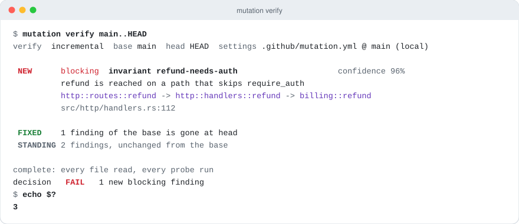
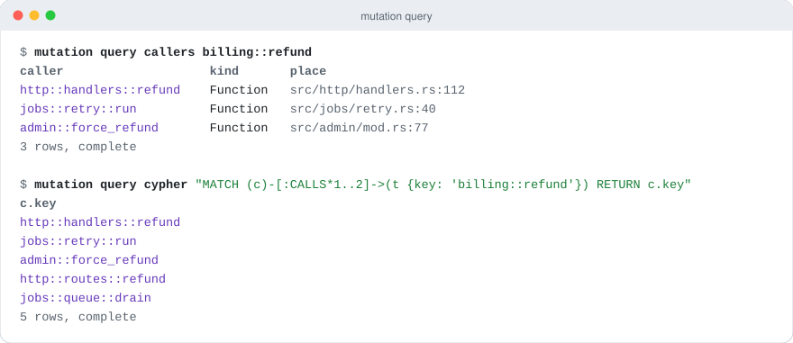

<h1 align="center">Mutation CLI</h1>

<p align="center"><b>Verify each change to your code before it lands, a person's or an agent's, and ask the repository how its code connects.</b></p>

<p align="center">
  <a href="#try-it">Try it</a> ·
  <a href="#what-it-gives-you">What it gives you</a> ·
  <a href="#how-it-works">How it works</a> ·
  <a href="#use-it-with-coding-agents">Agents</a> ·
  <a href="#use-it-in-cicd">CI/CD</a> ·
  <a href="#limits">Limits</a> ·
  <a href="docs/commands.md">Commands</a> ·
  <a href="#license">License</a>
</p>

`mutation` is one native binary that reads a local clone from any git host, builds a code graph with Mutation's own parsers, and answers from it:

- **`mutation verify`** runs probes on a change and on its base, compares their findings and decides **pass**, **fail** or **incomplete**, with an exit code a pipeline can act on.
- **`mutation query`** answers callers, callees, references, impact, call paths and metrics, or any question in standard SQL (with SQL/PGQ graph patterns) or openCypher.
- **`mutation context`** gives a coding agent the code around a target within a budget of tokens, each excerpt with its path and lines.

Code now arrives faster than people can read it, much of it written by agents. `mutation` gives you, your CI and your agents the same answer to two questions: what does this change touch, and does what the repository declares still hold?

By installing or using `mutation` you accept the [Mutation CLI License](LICENSE-BINARY) ([summary](#license)). The npm package named `mutation` without a scope is not Mutation's: always install `@mutationhq/cli`.

```sh
npm install --global @mutationhq/cli     # or: brew install mutationhq/tap/mutation (macOS and Linux)
mutation verify                          # in any git repository: your uncommitted changes against HEAD
```

No install: `npx @mutationhq/cli verify`. Builds for macOS on Apple silicon, Linux x64 and ARM64, and Windows x64 ([platforms](#platforms)).

<picture>
  <source media="(prefers-color-scheme: dark)" srcset="docs/assets/verify-dark.svg">
  
</picture>

## Try it

In any git repository, find a definition's key first, then ask about it:

```sh
mutation query find run --fuzzy                  # definitions whose name is like "run", each with its key
mutation query callers app::run                  # what calls it (use a key that find printed)
mutation query impact app::run                   # what depends on it, up to 64 hops
mutation context app::run --budget 4000          # the code around it, for an agent
mutation verify main..HEAD                       # the change from main to HEAD
```

`verify` exits 0 on pass, 3 when the change adds blocking findings and 4 when the decision is incomplete. The first command indexes the repository into `.mutation/data.mt`, which every worktree of the repository shares; later commands read only what changed. `mutation query catalog` lists what the index holds (its tables, kinds, languages and probes), and `--print-sql` shows the SQL behind any query.

<picture>
  <source media="(prefers-color-scheme: dark)" srcset="docs/assets/query-dark.svg">
  
</picture>

## What it gives you

- **A decision about the change, not a list of everything.** Findings on the change and its base are compared: each is new, fixed, standing or undetermined. A finding is anchored to a definition, not a line, so moving code does not make it new. By default only new blocking findings fail (`--fail-on new|blocking|none`).
- **Incomplete is never a pass.** When a probe did not run or a file was skipped, the answer says so and `verify` decides `incomplete` (exit 4), even under `--fail-on none`.
- **Rules you declare.** An invariant in `mutation.yml` says that a target function is reached only after a guard; `verify` reports a path that skips it:

  ```yaml
  # mutation.yml
  invariants:
    - id: refund-needs-auth
      description: A refund is issued only after the caller is authorized
      guard: require_auth
      target: refund
  ```

- **Settings a change cannot rewrite.** `verify` reads `mutation.yml` from the base of the change, or from a revision CI pins with `--settings`, and records which file, revision and digest it used.
- **Any input, without a checkout.** A revision, a comparison (`A..B`, or `A...B` from the merge base), the worktree, a patch on stdin (`git diff | mutation verify --patch - --at main`) or a folder without git.
- **Standard query languages.** SQL with SQL/PGQ's `GRAPH_TABLE`, and read-only openCypher, over definitions, uses, calls, imports, metrics and history. Every built-in query kind is SQL you can print and adapt.
- **Answers for programs.** Data on stdout, completeness and errors on stderr; `--format json`, `jsonl`, `csv`, `graphml`, `sarif`, `codeclimate`, `markdown`, `html` or `xml` as each command allows. Under a machine format an error is one JSON line with a stable `code`.

## How it works

<picture>
  <source media="(prefers-color-scheme: dark)" srcset="docs/assets/how-it-works-dark.svg">
  
</picture>

`mutation` is built on **Lingua**, Mutation's own lexers and parsers; it does not use tree-sitter. Files stream through it once. The graph it builds (definitions, references, calls, imports, metrics and history) is stored in one data file, and every command answers from that file rather than by reading the source again, so the same question at the same revision gets the same answer for each caller. Which languages the graph covers is listed by `mutation query catalog`.

**Measured.** The lexers on one CPU core of an Apple M-series Mac, 2026-11-21, best of five runs over about 4 MB of each language from Mutation's test corpora: Rust 1.24 GB/s; C 0.93, C++ 0.82, C# 1.04, Swift 0.99, Haskell 0.95, Lua 0.88, Ruby 0.93, SQL 0.80 and PHP 0.78 GB/s. Lexing is the first step of indexing, not the whole of it; these are not end-to-end times, and the harness is Mutation's own, not public.

## How it compares

By capability, against the kinds of tools people use for the same questions. This describes what each kind is usually built for, not a test of any one tool: tools within a kind differ, and many teams use several kinds together. ✓ means the kind is built for it; "some" means some tools of the kind do it; a blank means it is outside the kind's usual scope.

| | Text search, language servers | SAST scanners | Code-graph MCP servers | Context packers | `mutation` |
| --- | --- | --- | --- | --- | --- |
| Definitions, references, callers | ✓ (language servers) | | ✓ | | ✓ |
| Impact and call paths across the repository | some | some | ✓ | | ✓ |
| Questions in a standard query language | | own rule languages | some (Cypher) | | SQL with SQL/PGQ, openCypher |
| A pass or fail decision on a change against its base | | ✓ | some | | ✓ |
| Distinct exit codes for a failing change, a tool error and an incomplete answer | | some | | | ✓ |
| SARIF and GitLab Code Quality reports | | ✓ | some | | ✓ |
| Code for an agent within a token budget | | | some | ✓ | ✓ |
| Any revision, comparison or patch, without a checkout | | some | some | some | ✓ |
| Security rules maintained for many frameworks | | ✓ | | | |
| Runs locally | ✓ | ✓ | ✓ | ✓ | ✓ |

## Limits

- **It answers and decides; it does not edit.** It is not an editor, a language server or a bot that comments on pull requests. The CLI writes files and exit codes and publishes nothing to a git host.
- **Static links only.** Callers, impact and paths follow the links in the code; calls made through reflection or built at run time are not seen. Uses whose target is not one definition are listed as undecided (`undecided` in SQL) rather than guessed.
- **Bounded answers say they are bounded.** `--rows` (1,000 by default) and `impact --bound` (64 hops by default) cut an answer, and the answer says where; `--exact` makes a cut answer exit 4. `context` estimates tokens as UTF-8 bytes divided by 4.
- **A finding's confidence is shown, never used to decide.** Only blocking findings, as `--fail-on` counts them, change the decision.
- **Not every system.** Intel Macs, musl-based Linux (Alpine) and Windows on ARM are not supported. The source of `mutation` is not public.

## Use it with coding agents

The [`mutation` skill](skills/mutation/SKILL.md) teaches a coding agent the loop: understand the code with `query` and `context` before an edit, and run `mutation verify` before it says a task is done. It follows the open [Agent Skills](https://agentskills.io) format, so one skill serves every agent:

| Agent | Install |
| --- | --- |
| Claude Code | `/plugin install mutation --marketplace mutationhq/cli` |
| Codex CLI | `codex plugin marketplace add mutationhq/cli`, then `codex plugin add mutation@mutation` |
| Kiro CLI | `npx skills add mutationhq/cli -a kiro-cli` (add `-g` for every workspace) |
| Any other agent | `npx skills add mutationhq/cli` |

In Kiro IDE, add it as a power: **Powers**, then **Add Custom Power**, then import `https://github.com/mutationhq/cli`.

An agent without skills can still use `mutation` as it is: `mutation --help` and every command's `--help` describe its arguments, and `--format json` gives output to parse. A few lines in your `AGENTS.md` are enough:

```markdown
- Before editing a definition, run `mutation query callers <key>` and `mutation context <key> --budget 8000`.
- Before saying a task is done, run `mutation verify`. Exit 3: fix the new blocking findings. Exit 4: say the result is incomplete.
- Parse `--format json`; match an error's `code`, never its message.
```

## Use it in CI/CD

`mutation verify` exits 3 when a change adds blocking findings, so a pipeline fails on it without parsing output. Its reports feed your host's code scanning:

```yaml
# .github/workflows/mutation.yml
name: Mutation
on: pull_request
permissions:
  contents: read
  security-events: write
jobs:
  verify:
    runs-on: ubuntu-latest
    steps:
      - uses: actions/checkout@v4
        with:
          fetch-depth: 0
      - run: npx --yes @mutationhq/cli verify origin/${{ github.base_ref }}...HEAD --settings origin/${{ github.base_ref }} --output sarif=mutation.sarif
      - uses: github/codeql-action/upload-sarif@v3
        if: always()
        with:
          sarif_file: mutation.sarif
```

On GitLab, `--format codeclimate` gives the Code Quality report. `--settings` reads `mutation.yml` from the target branch, so a change cannot rewrite the settings it is verified against. `--output html=report.html` adds one self-contained HTML report.

> [!NOTE]
> **CI/CD for a private repository requires a Runner License after the evaluation, unless the repository is part of a Personal Non-Commercial Project.** `mutation` is free for personal and commercial use in a person's workstation development session, including agents and git hooks within that session. Pipeline Use is free for Public Repositories and Personal Non-Commercial Projects. Other Pipeline Use requires a paid Runner License from [mutation.sh/pricing](https://mutation.sh/pricing) after one 15-day evaluation per organization or independent individual. Hosted and self-hosted workflows are treated alike. Licensing is a legal requirement; the Software performs no license check. See sections 1.14–1.17 and 3.4 of the [licence](LICENSE-BINARY) for the definitions and evaluation rules.

## Commands

| Command | What it does |
| --- | --- |
| `verify [REV\|A..B]` | Run the workflow's probes on a change and its base, compare their findings, decide pass, fail or incomplete |
| `query <kind>` | Answer a question from the index: `sql`, `cypher`, `find`, `definition`, `outline`, `references`, `callers`, `callees`, `impact`, `path`, `diff`, `text`, `metrics`, `catalog` |
| `context [TARGET...]` | Give the code around targets within a budget of tokens, for an agent |
| `watch` | Verify the worktree each time it changes, one JSON line an event |
| `index [PATH]` | Index a revision or a history ahead of the commands that read it |
| `config show\|validate\|schema\|init` | Show, check, describe or write the settings |
| `completions SHELL` | Write a shell's completions: bash, zsh, fish, PowerShell, elvish |

Global options: `-C DIR`, `--format`, `--output FMT=FILE`, `--threads N`, `--no-index`, `--config FILE`, `--color auto|always|never`, `--quiet`. Every flag and format is in [commands](docs/commands.md).

## Configuration

The repository's settings live in `mutation.yml` (the first present of `.github/`, `.gitlab/`, then the root): invariants the code must hold, ignored paths, and how a review speaks on a host. `mutation config init` writes one with every default, and `mutation config validate` checks it with each error's line and column. The machine's settings (`threads`, `format`, `color`, `data`, `spill`, `update`) come from the user's `config.yml`, `MUT_*` variables and flags, in that order of precedence. An unknown key or variable is refused with exit 2. See [configuration](docs/configuration.md).

## Exit codes

| Code | Meaning |
| --- | --- |
| 0 | Done; `verify` decided pass |
| 1 | Failed: I/O, an output not written, a corrupt or incompatible data file |
| 2 | Usage: arguments, configuration, or a revision, key or patch that does not resolve |
| 3 | `verify` decided fail: blocking findings |
| 4 | Incomplete answer or decision |
| 130 | Interrupted |

See [exit codes](docs/exit-codes.md) for the error codes and which exit wins when several apply.

## Platforms

| Platform | npm package |
| --- | --- |
| macOS, ARM64 (Apple silicon) | `@mutationhq/cli-darwin-arm64` |
| Linux, x64, glibc 2.28 or newer | `@mutationhq/cli-linux-x64` |
| Linux, ARM64, glibc 2.28 or newer | `@mutationhq/cli-linux-arm64` |
| Windows, x64 | `@mutationhq/cli-win32-x64` |

Each build is one native binary with no runtime dependency. Archives for each platform are attached to each [GitHub Release](https://github.com/mutationhq/cli/releases), with a signed `SHA256SUMS` ([verifying releases](docs/verifying-releases.md)). Intel Macs, musl-based Linux (Alpine) and Windows on ARM are not supported. See [installation](docs/installation.md), including the CPU features each build requires.

`mutation` updates itself from where you installed it, a day after a release at the earliest, and never in CI; `update: notify` or `update: off` in your `config.yml`, or `MUT_UPDATE`, changes that ([updates](docs/installation.md#updates)).

## Documentation

[Installation](docs/installation.md) · [Commands](docs/commands.md) · [Configuration](docs/configuration.md) · [Exit codes](docs/exit-codes.md) · [Verifying releases](docs/verifying-releases.md) · [Privacy notice](docs/privacy.md) · [Legal documents](docs/legal.md) · [Model withdrawal form](docs/withdrawal-form.md) · [The npm packages](npm/README.md) · [Changelog](CHANGELOG.md)

This repository holds the CLI's documentation, its npm packages, its agent skills and its release files. The source of `mutation` is not public. Bugs and feature requests go to [issues](https://github.com/mutationhq/cli/issues) ([what a good report includes](CONTRIBUTING.md)); report a vulnerability privately to support@mutation.sh, never in a public issue ([SECURITY.md](SECURITY.md)).

## License

- **The `mutation` program** (the Software) is under the [Mutation CLI License](LICENSE-BINARY), which you accept by installing or using it. `mutation` is free for personal and commercial use in a person's workstation development session, including agents and git hooks within that session. Pipeline Use is free for Public Repositories and Personal Non-Commercial Projects. Other Pipeline Use requires a paid Runner License from [mutation.sh/pricing](https://mutation.sh/pricing) after one 15-day evaluation per organization or independent individual. Hosted and self-hosted workflows are treated alike. Licensing is a legal requirement; the Software performs no license check. See sections 1.14–1.17 and 3.4 of the [licence](LICENSE-BINARY) for the definitions and evaluation rules. A Runner License renews monthly or annually until you cancel it online, and consumers in the EU, the EEA and the UK may withdraw within 14 days ([model withdrawal form](docs/withdrawal-form.md)). Only Mutation publishes it, through the Official Channels: the npm packages under `@mutationhq`, the `mutationhq/homebrew-tap` formula and this repository's GitHub Releases. A byte-identical copy from a registry mirror, a proxy, a CDN or your organization's cache is covered too; redistributing or repackaging it is not allowed. To the extent the law allows, it comes without warranty (see the licence for the rights that the law keeps for you). Check each download's checksum and signature before you use it ([verifying releases](docs/verifying-releases.md)). Third-party components inside it keep their own licences, listed in `THIRD-PARTY-NOTICES` with each release.
- **This repository's Open Files**, including the docs, the agent skills, the npm launcher and manifests, the READMEs and the templates, are under the [MIT License](LICENSE). The Software, `LICENSE-BINARY` and `THIRD-PARTY-NOTICES` are outside that grant, and `CODE_OF_CONDUCT.md` is under CC BY 4.0. The `@mutationhq/cli` npm package holds the MIT-licensed launcher; the binary comes in the platform packages, under the Mutation CLI License.
- **Contributions:** pull requests are MIT with a DCO sign-off, and issues are Feedback under the licence ([contributing](CONTRIBUTING.md)).

[Legal documents](docs/legal.md) lists each of them, its version and whom it binds.

## Privacy

What `mutation` sends over a network, including its Telemetry and the controls a Runner License gives, is in the [privacy notice](docs/privacy.md).

## Export

The `mutation` binaries compute SHA-1 and SHA-256 hashes and contain no encryption for data confidentiality. You are responsible for complying with the export control and sanctions laws that apply to you; see section 14 of the [Mutation CLI License](LICENSE-BINARY).

## Trademarks

Mutation and the Mutation logo are trademarks of Mutation. Neither the MIT License nor the Mutation CLI License grants any right to use them, except to refer accurately to Mutation and its CLI. Do not publish a package, formula, image, binary or download under the Mutation name or a confusingly similar one. npm, Homebrew, GitHub, Apple, macOS, Windows and the other names here belong to their owners; their use does not imply endorsement.
