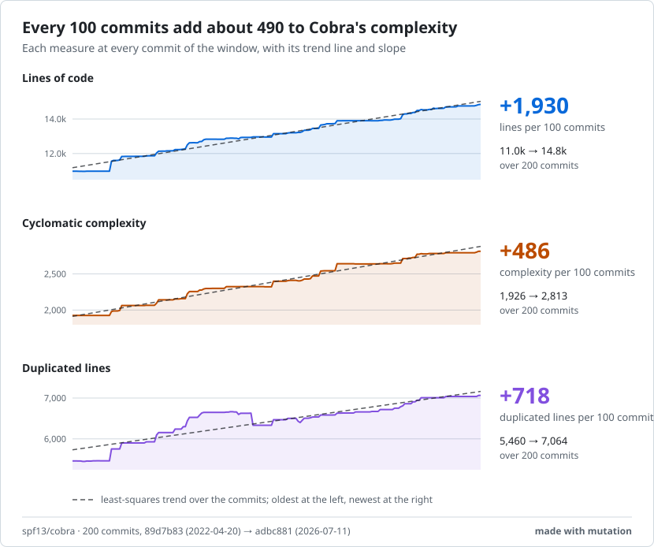
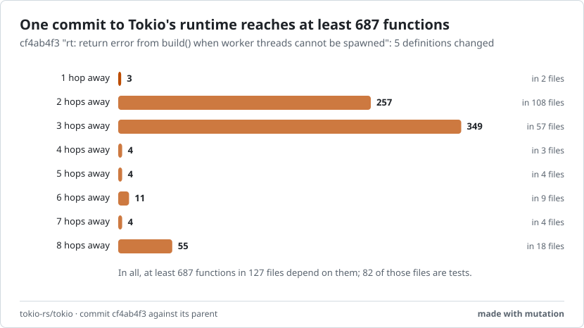
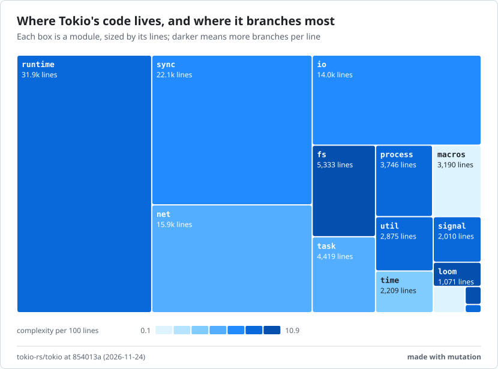
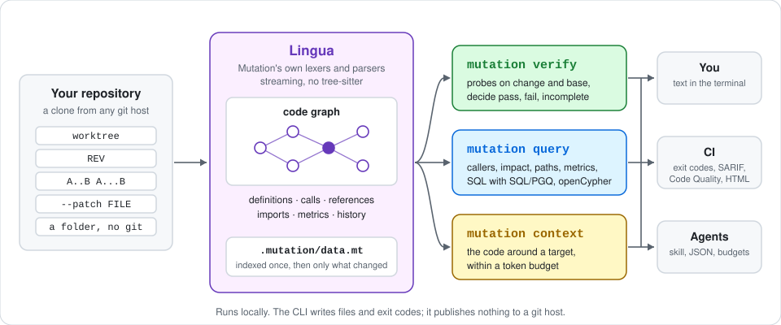

<h1 align="center">Mutation CLI</h1>

<p align="center"><b>Verify every change before it lands, and ask your code how it connects.</b></p>

<p align="center">
  <a href="#try-it">Try it</a> ·
  <a href="#see-it-on-real-code">Real code</a> ·
  <a href="#catch-a-broken-rule">Catch a broken rule</a> ·
  <a href="#where-it-fits">Where it fits</a> ·
  <a href="#use-it-with-coding-agents">Agents</a> ·
  <a href="#use-it-in-cicd">CI/CD</a> ·
  <a href="docs/commands.md">Commands</a> ·
  <a href="#license">License</a>
</p>

`mutation` reads a clone from any git host into a code graph, with Mutation's own parsers, and answers from it for you, your CI and your coding agents:

- **Verify**: does this change keep the repository's rules? `mutation verify` decides **pass**, **fail** or **incomplete** against the change's base, with an exit code CI and agents act on.
- **Query**: who calls this, what breaks if it changes, how one function reaches another; or any question in SQL or openCypher.
- **Context**: the code an agent needs around a target, within a token budget.
- **Reports**: `mutation verify --output html=report.html` writes one self-contained page with the findings and charts of the code.

<picture>
  <source media="(prefers-color-scheme: dark)" srcset="docs/assets/verify-dark.svg">
  
</picture>

**Languages.** The full graph (calls, impact, invariants) for Rust, Go, TypeScript, JavaScript, Python, Java, Kotlin, C, C++, Objective-C, C#, Swift, PHP, Ruby, shell scripts (sh, Bash, zsh), SQL, openCypher and Protobuf; lines, comments and duplicated code for over 200 more; JSON, TOML, YAML, XML, INI and Dockerfiles read whole, with the manifests of their build tools.

Installing or using `mutation` means you accept the [Mutation CLI License](LICENSE-BINARY).

```sh
npm install --global @mutationhq/cli     # or: brew install mutationhq/tap/mutation
cd your-repository
mutation query find main --fuzzy         # every definition named like main, with its key and place
mutation verify                          # your uncommitted changes against HEAD: pass, fail or incomplete
```

No install: `npx @mutationhq/cli verify`. Runs on macOS (Apple silicon), Linux (x64, ARM64) and Windows (x64). Use the `@mutationhq/cli` package, not the unscoped `mutation` one.

**Your code stays on your machine.** `mutation` sends nothing of your repositories anywhere. Its one network feature is updating itself, checked at most once a day and never in CI; `MUT_UPDATE=off` turns it off. The [privacy notice](docs/privacy.md) lists what each version sends, before that version ships.

> [!TIP]
> **Prefer it hosted?** [Mutation](https://mutation.sh) runs the same verification as a service on every pull request and merge request, on GitHub, GitLab and other git hosts, with results in the review and a console for your team.

## See it on real code

Charts from `mutation` on public repositories ([how each was made](docs/assets/gallery/SOURCES.md)):

<picture><source media="(prefers-color-scheme: dark)" srcset="docs/assets/gallery/trends-cobra-dark.svg"></picture>

<picture><source media="(prefers-color-scheme: dark)" srcset="docs/assets/gallery/reach-tokio-dark.svg"></picture>

<picture><source media="(prefers-color-scheme: dark)" srcset="docs/assets/gallery/treemap-tokio-dark.svg"></picture>

Make your own for any repository: `mutation verify --output html=report.html`.

## Try it

Take a key that `query find` printed, such as `app::run`, and ask about it:

```sh
mutation query callers app::run                  # what calls it
mutation query impact app::run                   # what depends on it
mutation context app::run --budget 4000          # the code around it, for an agent
mutation verify main..HEAD --output html=report.html   # verify a branch and write its report
```

The first command indexes the repository into `.mutation/data.mt`; later commands read only what changed. `mutation query catalog` lists what the index holds, including its languages and probes, and `--print-sql` shows the SQL behind any query.

<picture>
  <source media="(prefers-color-scheme: dark)" srcset="docs/assets/query-dark.svg">
  
</picture>

## Catch a broken rule

Write down a rule the code must keep, and `verify` holds every change to it. An invariant says a target function is reached only after a guard:

```yaml
# mutation.yml (mutation config init writes one with every default)
invariants:
  - id: refund-needs-auth
    description: A refund is issued only after the caller is authorized
    guard: require_auth
    target: refund
```

Commit it. Now a change that adds a path to `refund` around `require_auth` fails: `mutation verify` names the path, decides **fail** and exits 3. Fix the path and it passes with exit 0. `verify` reads `mutation.yml` from the base of the change, so a change cannot loosen the rules it is verified against. Without a `mutation.yml`, `verify` runs its default probes, which `mutation query catalog` lists.

**What a pass means.** Paths follow the calls written in the code; calls made through reflection or built at run time are not seen, and a call that does not resolve to one definition is listed as undecided (`undecided` in SQL), so you can see what a path could not follow. A finding's confidence is shown and never used to decide: only blocking findings change the decision.

<details>
<summary><b>Run it yourself</b>: a repository of five lines, a broken rule, its fix</summary>

```sh
mkdir shop && cd shop && git init -q
cat > mutation.yml <<'EOF'
invariants:
  - id: refund-needs-auth
    description: A refund is issued only after the caller is authorized
    guard: require_auth
    target: refund
EOF
cat > main.rs <<'EOF'
fn require_auth() {}
fn refund() {}
fn handle_refund() { require_auth(); refund(); }
fn main() { handle_refund(); }
EOF
git add . && git commit -qm "refunds behind auth"

# A change that skips the guard
cat > main.rs <<'EOF'
fn require_auth() {}
fn refund() {}
fn handle_refund() { require_auth(); refund(); }
fn retry_refund() { refund(); }
fn main() { handle_refund(); retry_refund(); }
EOF
mutation verify; echo "exit $?"    # fail: main -> retry_refund -> refund skips require_auth; exit 3

# The fix
sed -i.bak 's/fn retry_refund() { refund(); }/fn retry_refund() { require_auth(); refund(); }/' main.rs && rm main.rs.bak
mutation verify; echo "exit $?"    # pass; exit 0
```

</details>

What makes the decision one to rely on:

- **Only what the change did.** Findings on the change and its base are compared: new, fixed, standing or undetermined. A finding is anchored to a definition, not a line, so moving code does not make it new. By default only new blocking findings fail.
- **Incomplete is never a pass.** If a probe did not run or a file was skipped, the answer says so and `verify` decides **incomplete** (exit 4).
- **Any input.** A revision, a comparison (`A..B`, or `A...B` from the merge base), the worktree, a patch (`git diff | mutation verify --patch - --at main`) or a folder without git.

## How it works

<picture>
  <source media="(prefers-color-scheme: dark)" srcset="docs/assets/how-it-works-dark.svg">
  
</picture>

`mutation` is built on **Lingua**, Mutation's own lexers and parsers; it does not use tree-sitter. Files stream through it once into a graph of definitions, references, calls, imports, metrics and history, kept in one data file that every worktree shares. Every command answers from that file, never by reading the source again, so the same question at the same revision gets the same answer for each caller.

## Where it fits

- **Beside your language server.** It answers the same questions (callers, references) for any revision or patch, from a script, CI or an agent, and in SQL or openCypher.
- **Beside your SAST scanner.** A scanner brings maintained security rules; `mutation` holds the rules your repository declares and decides on the change against its base. Both write SARIF to the same code scanning.
- **For your agent.** Where a context packer hands over files, `mutation context` hands over the definitions around a target, within a token budget, and `verify` tells the agent whether its change holds.

## Use it with coding agents

The [`mutation` skill](skills/mutation/SKILL.md) teaches an agent the loop: understand the code with `query` and `context` before an edit, and run `mutation verify` before it says a task is done. One skill, in the open [Agent Skills](https://agentskills.io) format, serves every agent:

| Agent | Install |
| --- | --- |
| Claude Code | `/plugin install mutation --marketplace mutationhq/cli` |
| Codex CLI | `codex plugin marketplace add mutationhq/cli`, then `codex plugin add mutation@mutation` |
| Kiro CLI | `npx skills add mutationhq/cli -a kiro-cli` (add `-g` for every workspace) |
| Any other agent | `npx skills add mutationhq/cli` |

What that looks like: asked to retry failed refunds, the agent runs `mutation query callers billing::refund` to see who calls it and `mutation context billing::refund` to read the code around it, adds `retry_refund`, and runs `mutation verify`. Exit 3 names the path that skips `require_auth`; the agent adds the guard, runs `verify` again and reports the pass, exit 0.

In Kiro IDE: **Powers**, **Add Custom Power**, then import `https://github.com/mutationhq/cli`. Without skills, three lines in `AGENTS.md` do the same:

```markdown
- Before editing a definition, run `mutation query callers <key>` and `mutation context <key> --budget 8000`.
- Before saying a task is done, run `mutation verify`. Exit 3: fix the new blocking findings. Exit 4: say the result is incomplete.
- Parse `--format json`; match an error's `code`, never its message.
```

## Use it in CI/CD

`mutation verify` exits 3 when a change adds blocking findings, so the job fails without parsing output, and its SARIF feeds your host's code scanning:

```yaml
# .github/workflows/mutation.yml
name: Mutation
on: pull_request
permissions:
  contents: read
  security-events: write
jobs:
  verify:
    runs-on: ubuntu-latest
    steps:
      - uses: actions/checkout@v4
        with:
          fetch-depth: 0
      - run: npx --yes @mutationhq/cli verify origin/${{ github.base_ref }}...HEAD --settings origin/${{ github.base_ref }} --output sarif=mutation.sarif
      - uses: github/codeql-action/upload-sarif@v3
        if: always()
        with:
          sarif_file: mutation.sarif
```

`--settings` reads `mutation.yml` from the target branch. On GitLab, `--format codeclimate` gives the Code Quality report; `--output html=report.html` adds the HTML report as an artifact.

Public repositories run it in CI for free; private ones need a [Runner License](https://mutation.sh/pricing) after a 15-day evaluation, unless they are personal and non-commercial.

## Signed releases

Each release carries a `SHA256SUMS` signed with cosign, a provenance statement and a software bill of materials for every archive; the macOS binary is notarized and the Windows binary Authenticode-signed, and `mutation` checks the signature itself before it installs an update.

<details>
<summary>Check a download before you run it</summary>

```sh
sha256sum --check --ignore-missing SHA256SUMS          # macOS: shasum -a 256 --check --ignore-missing SHA256SUMS
cosign verify-blob --key cosign.pub --bundle SHA256SUMS.sigstore.json SHA256SUMS
```

`cosign.pub` is in this repository's root, and its fingerprint is published at [mutation.sh/security](https://mutation.sh/security). The rest is in [verifying releases](docs/verifying-releases.md).

</details>

## Reference

| Code | `verify` and every command exit with |
| --- | --- |
| 0 | Done; `verify` decided pass |
| 1 | Failed: I/O, an output not written, a corrupt data file |
| 2 | Usage: arguments, settings, or a revision or key that does not resolve |
| 3 | `verify` decided fail |
| 4 | Incomplete answer or decision |

- [Commands](docs/commands.md): `verify`, `query` and its 14 kinds, `context`, `watch`, `index`, `config`, `completions`, and every flag and format (`json`, `jsonl`, `csv`, `graphml`, `sarif`, `codeclimate`, `markdown`, `html`, `xml`).
- [Configuration](docs/configuration.md): the repository's `mutation.yml` and the machine's `config.yml` and `MUT_*` variables.
- [Exit codes](docs/exit-codes.md), [installation and updates](docs/installation.md), [verifying releases](docs/verifying-releases.md) (each release carries a signed `SHA256SUMS`), [changelog](CHANGELOG.md).

This repository holds the CLI's docs, npm launcher, agent skills and releases; the source of `mutation` is not public. Bugs and ideas go to [issues](https://github.com/mutationhq/cli/issues); report a vulnerability privately to support@mutation.sh ([SECURITY.md](SECURITY.md)).

## License

The `mutation` program is under the [Mutation CLI License](LICENSE-BINARY): free on your machine, including your agents and git hooks, and free in CI for public repositories and personal non-commercial projects; CI for other private repositories needs a [Runner License](https://mutation.sh/pricing). The docs, skills and npm launcher here are [MIT](LICENSE). See the [privacy notice](docs/privacy.md) and the [legal documents](docs/legal.md) for export and everything else.
